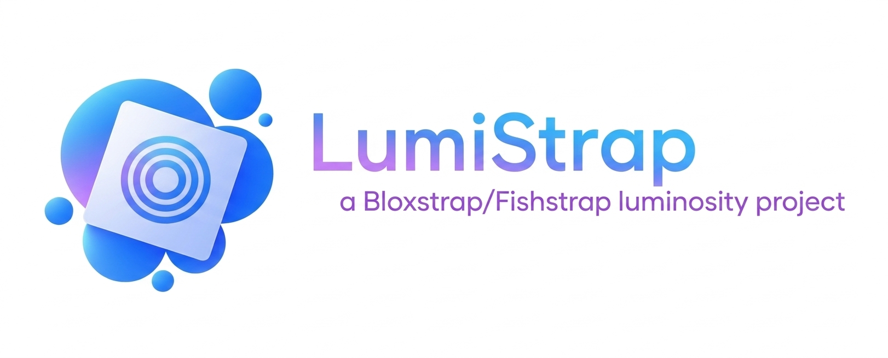

# LumiStrap

LumiStrap is a personal community fork of [Bloxstrap](https://github.com/bloxstraplabs/bloxstrap), an alternative bootstrapper for Roblox on Windows.



This fork adds LumiStrap branding, a blue and violet accent palette, and named profiles for LumiStrap preferences and custom Fast Flags. A profile saves configuration only; it does not copy Roblox files or downloaded mods.

The current source is based on Bloxstrap. Fishstrap features can be added individually as the project develops.

## Development status

This is an early personal build. The LumiStrap repository is available at [github.com/gggds2/LumiStrap](https://github.com/gggds2/LumiStrap); release downloads will appear on its [Releases page](https://github.com/gggds2/LumiStrap/releases). The build keeps its installation folder separate from Bloxstrap, and analytics remain disabled by default.

## Build from source

Use Windows with the .NET SDK version listed in `global.json`. Initialize the `wpfui` submodule, then restore and build the solution:

```powershell
git submodule update --init --recursive
dotnet restore
dotnet build -c Release
```

## License and attribution

LumiStrap is derived from Bloxstrap and retains its MIT license and upstream copyright notice in [`LICENSE`](LICENSE). Keep that file with any redistribution of this fork.
